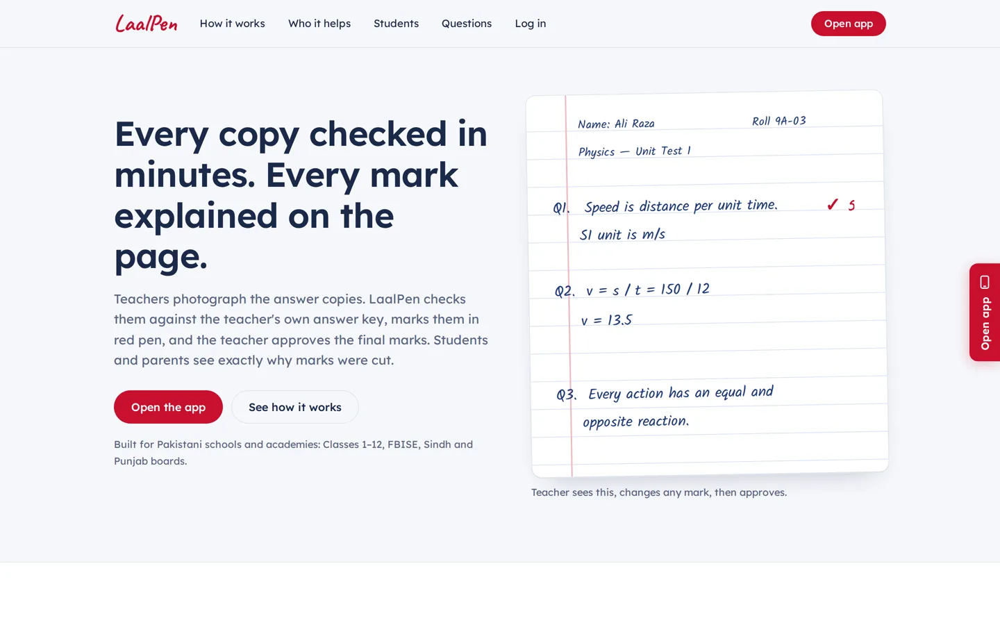
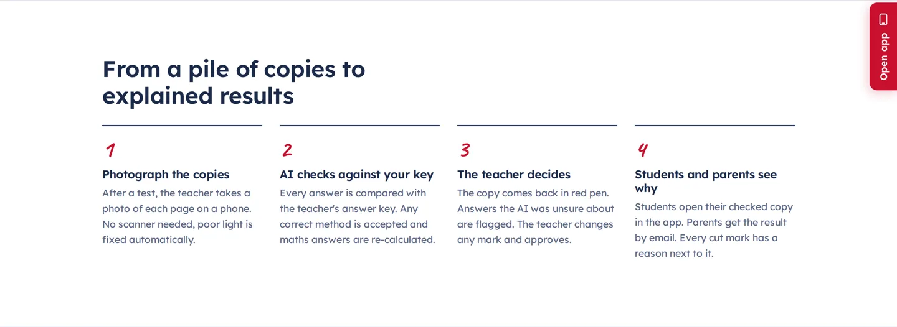
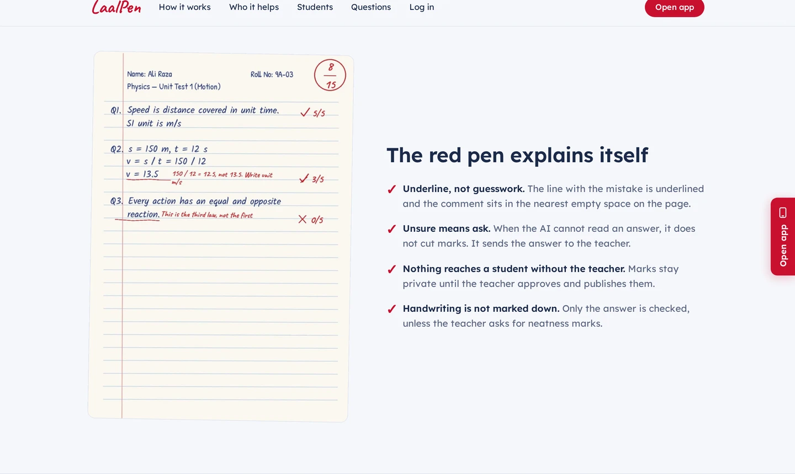
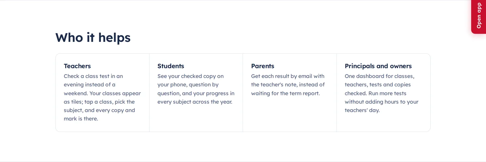
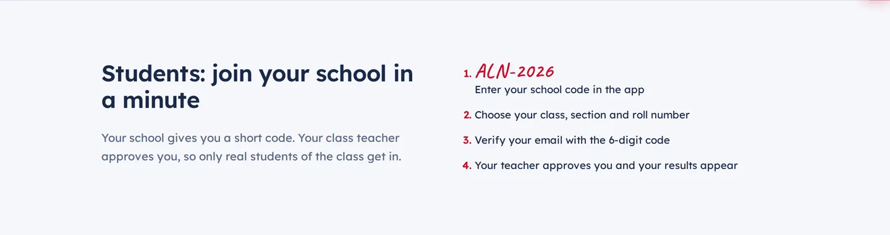
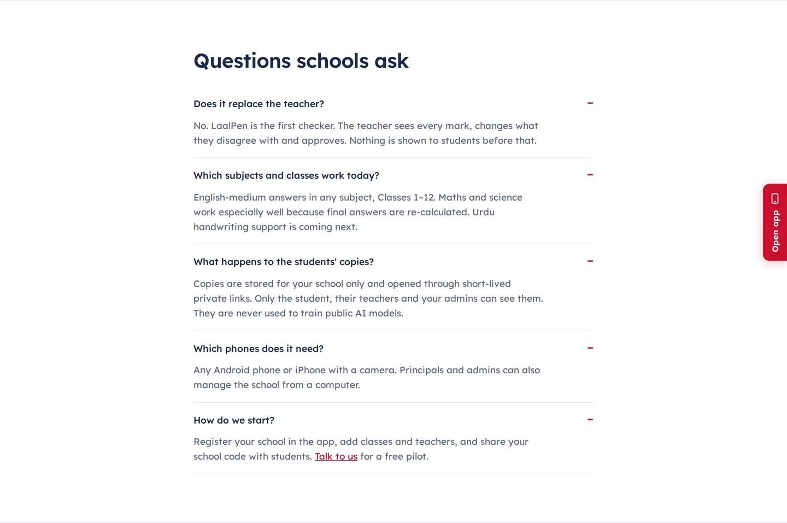
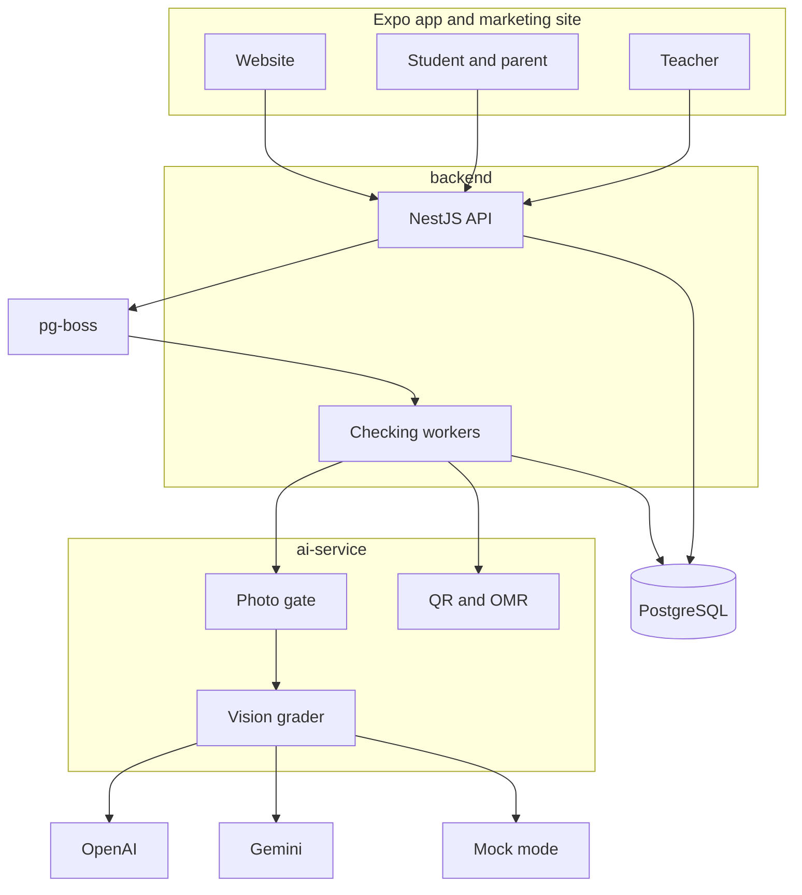

# LaalPen

Teachers photograph a class of answer copies. LaalPen checks them against the teacher's own answer key, marks the page in red pen, and waits for the teacher to approve. Students and parents then see the checked copy and why each mark was given.

Built for Pakistani schools and academies: Classes 1–12, FBISE, and the Sindh and Punjab boards. English and Urdu.

| | |
| --- | --- |
| Website and web app | https://laalpen.vercel.app |
| Android APK | https://laalpen.vercel.app/LaalPen.apk |

AI does the first check. The teacher decides the final marks. Nothing is published until a teacher approves it.

## Screenshots

From the public site. There is no separate pricing or about page; the sections below are the product.

The marked page on the site is an illustration, not a photograph of a real student.

## Features

**Checking.** A teacher confirms a marking scheme (final answer, steps, rules). Photos of a class can be taken in roll order, or dropped in a pile and sorted with printed QR booklets and stickers. Blur, darkness, glare, cut-off pages, and duplicates are rejected before a model is called. Each answer comes back Sure, Check, or Unreadable. MCQ bubble sheets can be scored without a model. Teachers approve sure copies, edit a mark, leave a voice note, and can reopen a published result with a reason.

**Roster.** Schools import a register from a spreadsheet, then accounts come later. Class codes and claim cards let a student who matches the register join immediately. Leaving a school keeps the marks. Promotion keeps an enrollment history.

**Roles.** The LaalPen owner (one super admin) adds each school and its principal. The principal completes the school profile and adds teachers; each teacher completes a profile (qualification, subjects, the classes they teach) and waits for the principal's approval before any student data opens. Staff never use passwords: they sign in with a single-use emailed code, a passkey (paused with an email alert after 3 failed tries), or Google for an account that already exists.

**Families.** Parent / Student is the only public sign-up: name, email (verified with a code), optional mobile number, password. They sign in with email or mobile number, add a child with one code box (class code like ALN-9A or a printed card code), and see every child, including from a link, without installing the app. Students see the checked copy, the trend, and what to practise. The student and parent screens switch to Urdu (right to left, Nastaliq).

**Principal.** Time from photo to result, copies waiting on each teacher, a topic-by-class view, and a spreadsheet export for board records. The activity log cannot be edited or deleted.

The sample pages are illustrations. This project does not publish an accuracy score from real classroom copies. A larger set, marked independently by two teachers, is the bar before any number would be claimed.

## Architecture

| Part | Role |
| --- | --- |
| `app/` | Expo app for Android, iOS, and web, plus the marketing site |
| `backend/` | Accounts, roster, queue, and notifications |
| `ai-service/` | Reading the page, scoring, QR and OMR, red-pen drawing |
| `e2e/` | Browser walkthrough of a school year |

The model quotes what the student wrote before it awards marks. Blank answers stay at zero. Unreadable answers are never silently scored zero. Totals are added in application code. Numeric answers are checked again outside the model, and multiple-choice answers are compared in code. Only uncertain theory answers get a second look.

## Tech stack

| Layer | Choice |
| --- | --- |
| App | Expo SDK 57, React Native, React Native Paper, Expo Router |
| API | NestJS 12, Prisma 7, PostgreSQL 16, pg-boss |
| Checker | FastAPI, OpenAI vision, optional Gemini for Urdu, OpenCV, SymPy, Pillow |
| Sign-in | Staff: emailed one-time code, passkeys, Google (existing accounts only), optional authenticator app. Parent / Student: email or mobile number + password, Google. |
| Files | Local disk, or S3-compatible storage |
| Delivery | Website on Vercel, API on Render, Android APK from the site |

## Roadmap

Shipped: roster and capture, parent results, QR booklets, OMR sheets, principal insights, passkeys, and Urdu on the family screens. The phase list is in [`ROADMAP.md`](ROADMAP.md).

Still ahead:

- Agreement with teachers measured on real double-marked copies, before any accuracy number is published
- Passkeys in a store build, and a document scanner on the phone
- Urdu across the rest of the app
- Board-specific column orders on the export

## Author

**Syed Abdul Maarij** — full-stack engineer.

- GitHub: [maarijwaseem2](https://github.com/maarijwaseem2)
- LinkedIn: [maarijwaseem2](https://www.linkedin.com/in/maarijwaseem2)
- Product: [laalpen.vercel.app](https://laalpen.vercel.app) · hello@laalpen.pk

MIT license, copyright 2026 Syed Abdul Maarij. See [LICENSE](LICENSE).
